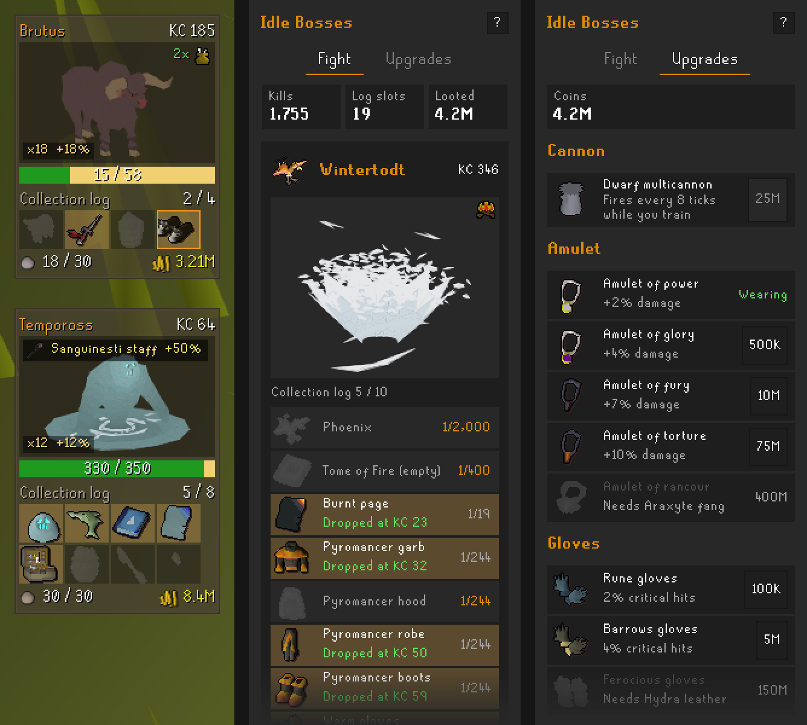

# Idle Bosses

**Bored of skilling?** Hours of laps, logs and essence, and nothing to show for it but a number going up. Idle Bosses
gives your XP something to hit.

Idle Bosses is a [RuneLite](https://runelite.net/) plugin for Old School RuneScape. Every XP drop hits a boss in a box
on your screen. It takes the hits, dies and drops loot from its drop table. Fill collection logs to climb a ladder of 70
bosses, from Obor to the Fractured Archive.

> **None of it is real.** The bosses, loot, coins and collection logs only exist inside the plugin, on your screen. You
> don't fight anything in the game, and nothing goes into your bank or your in-game collection log.

  

## How it works

- **Every XP drop is a hit.** Damage is balanced for each skill, so an hour of Runecraft hits about as hard as an hour
  of Agility. Most kills take 15 seconds to 4 minutes of normal training.
- **Bosses you know.** Each boss uses its in-game model and animations, and every kill rolls the boss's drop table at
  the Wiki's rates, pets included.
- **Collection logs unlock bosses.** Each boss needs log slots from across all your logs, plus a few kills of the boss
  before it. A finished log turns gold.
- **Weaknesses.** Every boss takes double damage from one skill, shown by that skill's icon, like Mining for the Giant
  Mole.
- **Upgrades.** Loot is worth coins, which buy amulets, gloves, 16 weapons with their own special effects and a dwarf
  multicannon. The best ones also need the item in your collection log.
- **Streaks and superiors.** Each kill in a row adds 1% damage, up to 25%. About 1 kill in 30 brings out a superior with
  an extra loot roll.

Hitpoints and Slayer XP don't hit, because they only come with combat XP. Progress is saved for each account.

## Getting started

1. Install **Idle Bosses** from the Plugin Hub.
2. Go skilling. Obor, Bryophyta and Brutus are open from the start, and the boss appears in a box on screen. Hold Alt
   and drag it to move it.
3. Open the **Idle Bosses** sidebar panel to pick a boss, see its collection log and spend your coins.

Each sidebar tab opens with a short guide card. The **?** by the heading brings it back.

## Settings

- **Show HUD** and **Show boss in HUD**: the on-screen box, and the animated boss inside it.
- **Walking mini boss**: off by default. A small boss follows you around the game world, only on your screen.
- **Chat messages** and **Rare drop sound**: kills, new log items and unlocks in chat, and a sound for pets and rare log
  items.
- **Reload cannon**: a key that reloads your cannon.

Every boss, unlock and upgrade is in the [full guide](docs/guide.md).

## Data

Drop tables come from the [Old School RuneScape Wiki](https://oldschool.runescape.wiki/). See `docs/drop-sources.md`
for the pages and revisions used, and `tools/fetch_drops.py` rebuilds `src/main/resources/com/idlebosses/drops.json`
from them. The plugin is BSD-2 (see `LICENSE`).

Boss models, animations, item icons, hitsplats and sounds are loaded from your game client while it runs. None are
included in the plugin.

## Say hi

Made by **Krypt0fy** (that's a zero, not an o). Found a bug, want a boss added, or just got a pet and need someone to
say gz? Add me in game.

None of the loot in this plugin is real, but GP is. If Idle Bosses got you through a 10-hour Agility grind, tips in
game are very welcome. They're the rarest drop in here, and I'm on a long dry streak.

I'll never ask for your password, bank PIN or items. And if a "Krypt0fy" offers to double your money, that's not me.
That's never anyone.
